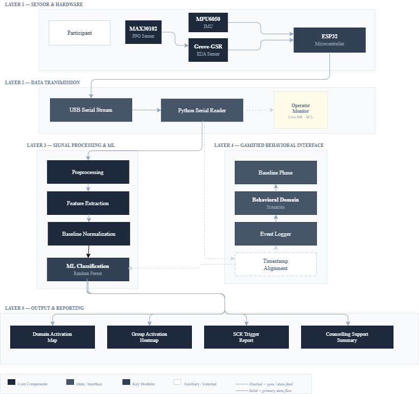

# Pulse: Gamified Stress Detection

Engineering research prototype mapping autonomic stress activation across seven behavioral domains in young adults (15-25 years) using wearable PPG, GSR, and IMU sensors integrated with a custom gamified simulation interface.

---

## Project Overview

Design and validate a domain-based interactive simulation framework that maps autonomic physiological responses (HRV + EDA) to structured behavioral contexts without diagnosing or labeling individuals. The output is a domain-level activation radar chart per subject, driven by event-aligned physiological data captured during live gamified scenarios.

### Core System Features
* **Hardware-Software Integration:** A Python based gamification engine that synchronizes in-game behavioral events with live wearable biosensor streams to accurately map stress responses to specific cognitive scenarios.
* **Signal Processing & Cleaning:** The pipeline processes raw biosignals using Butterworth filters and NeuroKit2 EDA decomposition, implementing a strict IMU-based motion gate to automatically reject physical artifacts.
* **Machine Learning & Generalization:** Features a subject-independent Random Forest model validated against both benchmark and real world datasets, generalizing from 95.9% accuracy on the WESAD benchmark to an 86% accuracy (AUC 0.902) on live custom hardware testing.

---

## Pipeline Architecture



---

## Documentation Directory

For deep dives into the project's design, hardware setup, and research outcomes, please refer to the following documentation:

**System & Technical Specs:**
* [System Architecture](docs\specs\ARCHITECTURE.md) - High-level system design and data flow.
* [Gamification Interface Spec](docs/specs/INTERFACE_SPEC.md) - Details on the 7 cognitive domains and the 14 simulated scenarios.
* [Master System Reference](docs/specs/SYSTEM_REFERENCE.md) - Consolidated hardware definitions, constants, and project glossary.


---

## Current Status: Live Pilot Study (Complete)

- **End-to-End Orchestration:** The entire pipeline is now fully automated via a single CLI tool (`run_session.py`). It manages serial connection checks, background data capture, Pygame launch, timestamp alignment, feature extraction, and instantaneous radar chart generation.
- **Pilot Expansion:** Conducted a Phase 3 live human pilot study (N=7 subjects). 
- **Robustness Validated:** Implemented strict baseline normalization guards (`n ≥ 4` valid 30s windows required). The IMU motion-gating successfully caught and rejected excessive fidgeting artifacts during baseline rests, demonstrating real-world noise resilience.

---

## Quickstart

### Prerequisites
* Python 3.11+ (Python 3.13 recommended)
* Package manager: [`uv`](https://docs.astral.sh/uv/)

### Installation
```bash
# Install all dependencies and setup the virtual environment
uv sync
```

### Running a Live Subject Session
To launch a complete recording session (checks sensors, starts background recording, runs the game, and generates the final radar chart reports):
```bash
uv run python run_session.py --subject S01
```
*(Use `--fast-baseline` for testing purposes to skip the 3-minute resting baseline).*

---

## Repository Structure

```text
Pulse/
├── assets/                 # Static media assets (audio/visuals)
├── docs/                   # Centralized documentation
│   ├── reports/            # Pilot results and comprehensive research reports
│   ├── specs/              # Interface, architecture specs, and system references
│   └── CHANGELOG.md        # Detailed progress and update tracker
│
├── firmware/               # Microcontroller C++ code
│   └── firmware.ino        # ESP32 66.67 Hz sampling sketch (GSR, PPG, IMU)
│
├── scripts/                # Execution & Utility scripts
│   ├── analysis/           # Radar plotting, feature extraction, ROC curves
│   ├── hardware_checks/    # Hardware go/no-go verification scripts
│   └── training/           # ML training and zero-shot evaluation scripts
│
├── src/                    # Core Application Code
│   ├── game/               # Gamification Engine (Pygame state machine)
│   ├── hardware/           # Serial acquisition and live logging
│   ├── pipeline/           # ML, signal processing, filters, and feature extraction
│   └── align_signals.py    # Merges hardware CSVs with game event logs
│
├── tests/                  # Pytest automated test suite
├── .gitignore              # Ignores generated outputs/, data/, and .venv/
├── pyproject.toml          # Project metadata and dependencies
└── run_session.py          # Primary CLI Orchestrator
```
